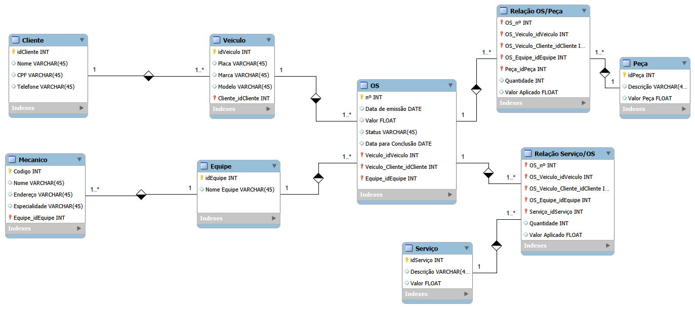

# 🚗 Modelo Relacional para Oficina Mecânica

Este repositório contém a modelação de uma base de dados para um sistema de gestão e controlo de ordens de serviço (OS) numa oficina mecânica. O projeto foi desenvolvido para mapear corretamente as entidades envolvidas no dia a dia da oficina, garantindo a integridade do histórico financeiro e operacional.

## 📊 Diagrama da Base de Dados

## ⚙️ Regras de Negócio e Estrutura

O modelo foi desenhado para atender aos seguintes requisitos operacionais:
- **Clientes e Veículos:** Relacionamento 1:N que permite a um cliente registar e gerir múltiplos veículos no sistema.
- **Equipas e Mecânicos:** Os mecânicos, com as suas respetivas especialidades, são agrupados em equipas de trabalho (1:N).
- **Gestão de Ordens de Serviço (OS):** Entidade central do sistema. Cada OS vincula um veículo específico a uma equipa responsável pela execução, controlando o status de aprovação do cliente, datas e valor total.
- **Histórico de Peças e Serviços (N:M):** Utilização de tabelas associativas (`Relação OS/Peça` e `Relação Serviço/OS`). Além de conectarem os catálogos de peças e serviços de referência à OS, estas tabelas registam a **quantidade** e o **valor aplicado** no momento exato do fecho da ordem, garantindo que alterações futuras nos preços da tabela base não afetem o histórico de OS antigas.

## 🛠️ Ferramenta Utilizada
- MySQL Workbench
